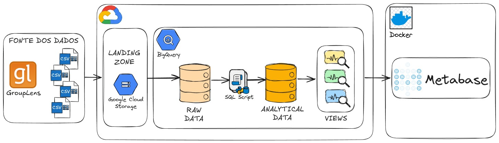
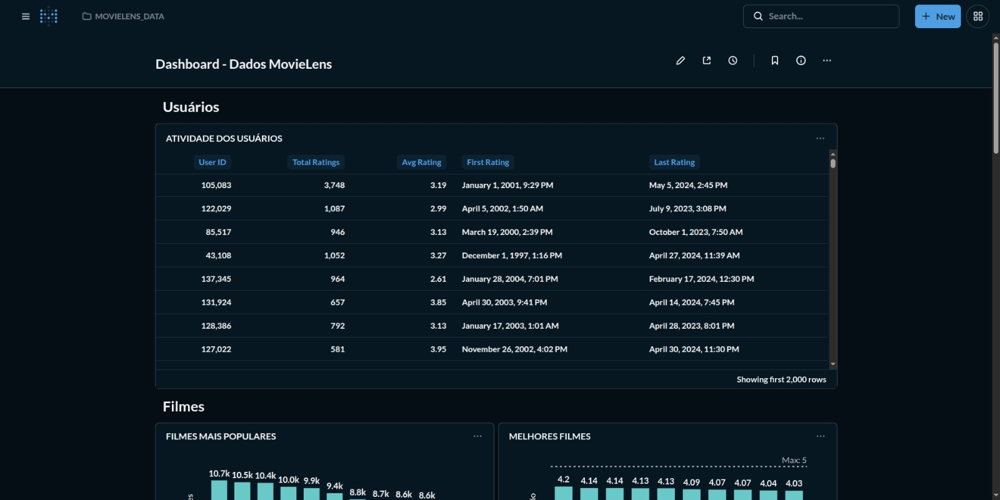
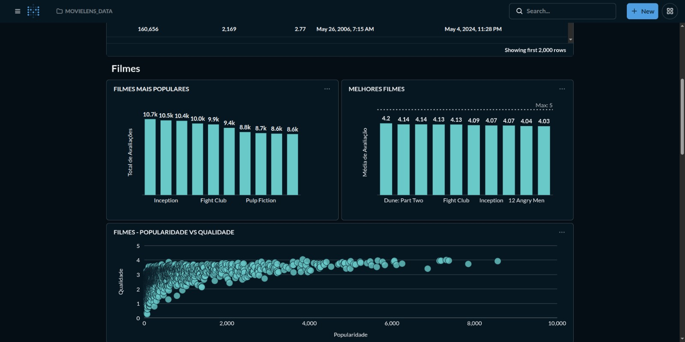
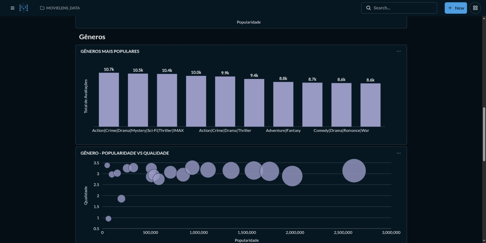
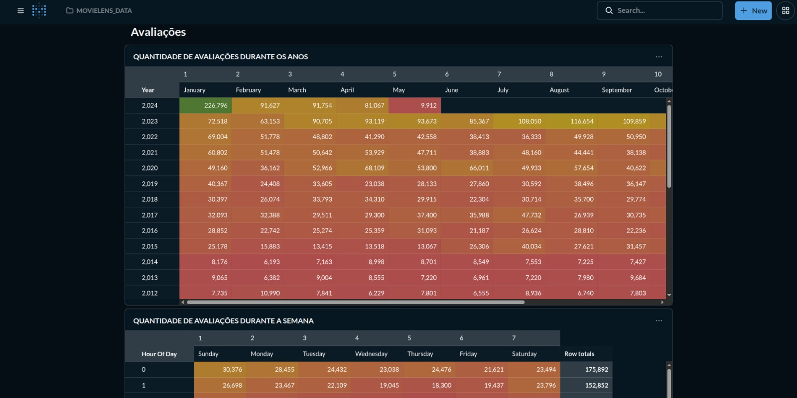

# MovieLens Analytics End to End

Projeto end-to-end para extração, modelagem dimensional e visualização de dados de entretenimento (MovieLens).


## Overview

Este projeto implementa um workflow de dados **ELT** utilizando **Python** para automação da ingestão e **Google Cloud Platform** para processamento escalável. O objetivo é transformar arquivos brutos do GroupLens em um ambiente analítico no **BigQuery**, com visualização final via dashboards no **Metabase**.





## Tech Stack

* **Cloud / Data:** Google Cloud Storage (GCS) e BigQuery
  
* **BI / Visualização:** Metabase
  
* **Infraestrutura Local:** Docker (Containerização do Metabase)
  
* **Linguagem:** Python 3.12 e SQL (BigQuery Standard SQL)


## Estrutura do Projeto

```text
.
├── pipeline/           # Scripts Python de automação (Extract & Load & Transform)

├── sql/                # Scripts de modelagem analítica e views
│   ├── dimensions/     # Tabelas de Dimensão (dim_movies)
│   ├── facts/          # Tabelas de Fatos (fact_ratings)
│   └── views/          # Camada semântica para dashboards

├── notebooks/          # Análise exploratória (EDA)

├── docker/             # Configuração para Metabase (Docker Compose)

├── config/             # Gerenciamento de chaves

└── data/               # Arquivos CSV originais (MovieLens)
```


## Processo de ELT

* **Extraction:** Scripts **Python** realizam o processamento dos arquivos .csv e .zip da fonte GroupLens.

* **Loading:** Carga automatizada dos dados para o **Google Cloud Storage (GCS)** na camada Raw e criação de External Tables no **BigQuery**.

* **Transformation:** Modelagem dimensional **(Star Schema)** no **BigQuery** utilizando **SQL** para limpeza, criação de tabelas de Fato/Dimensão e construção de **Views** de negócio.

## Dashboard

A camada de visualização é servida através de uma instância do **Metabase** integrada diretamente ao **BigQuery**. Os dashboards foram projetados para responder a perguntas de negócio sobre o consumo de mídia e engajamento.

* **Infraestrutura:** Deploy via **Docker** para garantir portabilidade e isolamento do ambiente de BI.

* **Visões Analíticas:** Consumo de dados via Views **SQL**, garantindo performance e uma camada semântica limpa.

* **KPIs Monitorados:**

  * **Performance de Catálogo:** Ranking dos filmes melhor avaliados e mais populares.

  * **Análise de Gêneros:** Distribuição de avaliações por categoria e volume de títulos.

  * **Engajamento de Usuários:** Histórico de atividade e mapas de calor de ratings.

  * **Qualidade vs. Popularidade:** Identificação de tendências e outliers de mercado.








